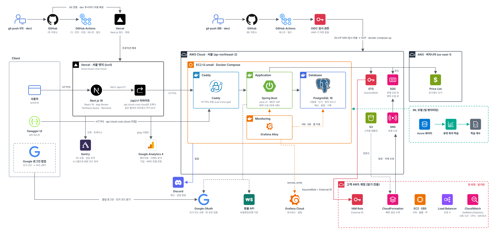

# CloudCost Backend

> AWS 계정을 **읽기 전용 IAM Role**로 연결하기만 하면,
> 내 EC2가 얼마나 켜져 있었고 비용이 얼마쯤 나왔는지 바로 보여 줍니다.
> Access Key는 받지 않고, 고객 리소스는 절대 바꾸지 않습니다.

<br />

## Architecture


<br />

## API Docs

| 구분 | URL |
|------|-----|
| Swagger UI | `http://localhost:8080/swagger-ui.html` |
| OpenAPI | `http://localhost:8080/v3/api-docs` |
| 로그인 테스트 | `http://localhost:8080/login.html` |

<br />

## 주요 기능

<table>
  <tr>
    <td align="center" width="33%">
      <b>원클릭 AWS 연결</b>
      <br />
      <sub>CloudFormation 빠른 생성 링크 → 체크 1개 → 연결 완료<br />SNS·SQS 신호로 자동 검증</sub>
    </td>
    <td align="center" width="33%">
      <b>EC2 사용 시간</b>
      <br />
      <sub>CloudWatch 기록으로 켜져 있던 시간 계산<br />연결 직후 90일 소급, 일별·월별 집계</sub>
    </td>
    <td align="center" width="33%">
      <b>추정 비용</b>
      <br />
      <sub>사용 시간 × 온디맨드 단가 (Price List)<br />실제 청구 금액이 아닌 <code>estimated_on_demand</code></sub>
    </td>
  </tr>
  <tr>
    <td align="center" width="33%">
      <b>고객 비용 보호</b>
      <br />
      <sub>조회 시점 수집 + DB 캐시<br />인스턴스 10분, CloudWatch 계정당 1시간 1회</sub>
    </td>
    <td align="center" width="33%">
      <b>Google 로그인</b>
      <br />
      <sub>Google ID 토큰 검증 → 자체 JWT 발급<br />비밀번호를 받거나 저장하지 않음</sub>
    </td>
    <td align="center" width="33%">
      <b>읽기 전용 보안</b>
      <br />
      <sub>고객 계정 허용 API 2개만 호출 (ArchUnit 강제)<br />사용자별 데이터 격리, 남의 리소스는 404</sub>
    </td>
  </tr>
</table>

<br />

## 기술 스택

### Backend
- **Java 21**
- **Spring Boot 3.5** - Spring Web MVC, Validation
- **Spring Data JPA** - ORM
- **Springdoc OpenAPI** - Swagger UI

### Database
- **PostgreSQL 16**
- **Flyway** - DB 마이그레이션

### AWS 연동 (AWS SDK for Java v2)
- **STS** - 고객 Role AssumeRole (+External ID)
- **EC2 · CloudWatch** - 인스턴스 정보, 사용 시간 (고객 계정, 읽기 전용)
- **Price List** - 온디맨드 단가 (우리 계정)
- **SNS · SQS · CloudFormation** - 원클릭 연결 신호

### 인증
- **Google Identity Services** - 로그인
- **Nimbus JOSE + JWT** - Google ID 토큰 검증, 자체 JWT 발급

### 테스트
- **JUnit 5 · Mockito · AssertJ**
- **ArchUnit** - 헥사고날 의존 규칙, 허용 AWS API 검사
- **H2** - 테스트용 DB (실제 AWS 호출 없음)

### 인프라 · 배포
- **EC2 + Docker Compose** - Caddy(HTTPS 자동) → 앱 → PostgreSQL
- **GitHub Actions** - CI(테스트), CD(자동 배포, AWS는 OIDC)
- **Grafana Cloud + Alloy** - 서버(VM)·PostgreSQL·앱(Actuator/Micrometer) 지표 모니터링 (서버 밖에서 확인)

<br />

## 프로젝트 구조

헥사고날 아키텍처를 따르며, 의존 방향은 ArchUnit 테스트로 강제합니다.

```text
src/main/java/com/cloudcost/
  CloudCostApplication.java
  domain/                 # 순수 Java: 사용 시간·추정 비용 계산, 캐시 정책, ARN·External ID (Spring·AWS·JPA 금지)
    account/              # AWS 연결, External ID, 고객 Role 정책, 빠른 생성 링크
    ec2/                  # 인스턴스 정보, 수집 상태
    usage/                # 사용 시간 계산, 일별·월별 집계, CloudWatch 조회 구간
    cost/                 # 추정 비용, Price List 조회 조건
    user/                 # 사용자, 외부 로그인 신원
    sync/                 # 수집 기록
  application/            # 유스케이스 + 포트(interface) (AWS SDK·JPA 직접 사용 금지)
    port/
  adapter/                # 포트 구현 (AWS SDK는 여기서만)
    awscustomer/          # 고객 계정: STS·EC2·CloudWatch
    awsinternal/          # 우리 계정: Price List·SQS·CloudFormation 응답
    auth/                 # Google ID 토큰 검증, JWT
    persistence/          # JPA 엔티티, Repository (owner 조건 필수)
  entrypoint/
    api/                  # REST 컨트롤러, 인증(owner 해석), 예외 처리
    worker/               # 스택 신호 SQS 폴러
    config/               # 조립(wiring), 설정, Swagger

src/main/resources/
  application.yml         # 공통 설정 (값은 환경 변수)
  application-local.yml   # 로컬 프로필
  application-prod.yml    # 운영 프로필
  db/migration/           # Flyway 마이그레이션
  cloudformation/         # 고객용 Read Only Role 템플릿
  static/login.html       # 로그인 테스트 페이지

deploy/                   # Dockerfile, docker-compose, Caddyfile, 배포 스크립트
docs/                     # 아키텍처·API·데이터 모델·보안·배포 문서, ADR
.github/                  # GitHub Actions, 이슈·PR 템플릿
```

<br />

## 시작하기

### 요구사항

- Java 21
- Docker (로컬 PostgreSQL)
- AWS CLI 프로필 (실제 AWS 연결 시, [docs/AWS_SETUP_GUIDE.md](docs/AWS_SETUP_GUIDE.md))

### 테스트

실제 AWS를 호출하지 않습니다 (H2 + fake AWS 어댑터).

```bash
./gradlew test
```

특정 테스트만 실행할 때는 다음 형식을 사용합니다.

```bash
./gradlew test --tests com.cloudcost.application.UsageRefreshTest
```

<br />

## CI/CD

GitHub Actions로 테스트와 배포를 자동화합니다.

| 워크플로우 | 트리거 | 내용 |
|-----------|--------|------|
| `ci.yaml` | `dev`, `main` 대상 PR · `main` push | JDK 21 → `./gradlew test` → 실패 시 테스트 리포트 업로드 |
| `cd.yaml` | `dev` push (머지) | CI 통과 → jar 빌드 → OIDC로 AWS 역할 → 러너 IP만 SSH 임시 허용 → 서버로 복사 → `docker compose up -d --build` → 기동 확인 → SSH 허용 해제 |

설정 방법: [docs/DEPLOY.md](docs/DEPLOY.md) 10절

<br />

## 개발 규칙

- 계산(사용 시간, 비용, 캐시 판단)은 `domain/`에 두고 프론트에서 계산하지 않습니다.
- 고객 AWS 계정에는 `ec2:DescribeInstances`, `cloudwatch:GetMetricStatistics`만 호출합니다. 권한 추가는 ADR이 먼저입니다.
- 모든 사용자 데이터 조회는 `owner_id` 조건을 겁니다. `findById`·`findAll` 같은 owner 없는 조회를 만들지 않습니다.
- DB 스키마 변경은 `src/main/resources/db/migration/`에 새 Flyway 파일로 추가합니다. 적용한 파일은 고치지 않습니다.
- API·테이블을 바꾸면 `docs/API.md`, `docs/DATA_MODEL.md`도 함께 고칩니다.
- 민감한 값(키, 비밀번호, 실제 계정 ID·ARN)은 커밋하지 않고 환경 변수 또는 배포 Secret으로 관리합니다.

<br />

## 브랜치 전략

```text
main                     # 안정 버전
dev                      # 개발 통합 · 머지되면 자동 배포
feat/#이슈번호-기능명
fix/#이슈번호-버그명
```

예시:

```text
feat/#12-cost-forecast
fix/#34-usage-timezone
```

<br />

## 커밋 컨벤션

| 타입 | 설명 |
|------|------|
| `feat` | 새로운 기능 |
| `fix` | 버그 수정 |
| `refactor` | 코드 리팩토링 |
| `docs` | 문서 수정 |
| `test` | 테스트 코드 |
| `chore` | 빌드, 설정, 배포 변경 |

예시:

```text
feat: 일별 추정 비용 API 추가
fix: KST 날짜 경계 사용 시간 집계 오류 수정
```

<br />

## PR 규칙

- 이슈를 먼저 만들고 이슈 템플릿(feature·refactor·fix·chore)을 사용합니다.
- `dev`로 PR을 올리고 [PR 템플릿](.github/PULL_REQUEST_TEMPLATE.md)의 체크리스트를 채웁니다.
- CI(`./gradlew test`)가 통과해야 머지합니다. 머지하면 자동 배포됩니다.

<br />

## 문서

| 문서 | 내용 |
|------|------|
| [docs/ARCHITECTURE.md](docs/ARCHITECTURE.md) | 헥사고날 구조, 수집·캐시 흐름, 환경 변수 |
| [docs/API.md](docs/API.md) | API 계약 |
| [docs/DATA_MODEL.md](docs/DATA_MODEL.md) | 테이블 |
| [docs/SECURITY.md](docs/SECURITY.md) | 보안 규칙 |
| [docs/AWS_SETUP_GUIDE.md](docs/AWS_SETUP_GUIDE.md) | AWS 계정 준비 |
| [docs/DEPLOY.md](docs/DEPLOY.md) | EC2 배포, CI/CD |
| [docs/decisions/](docs/decisions/) | ADR |
