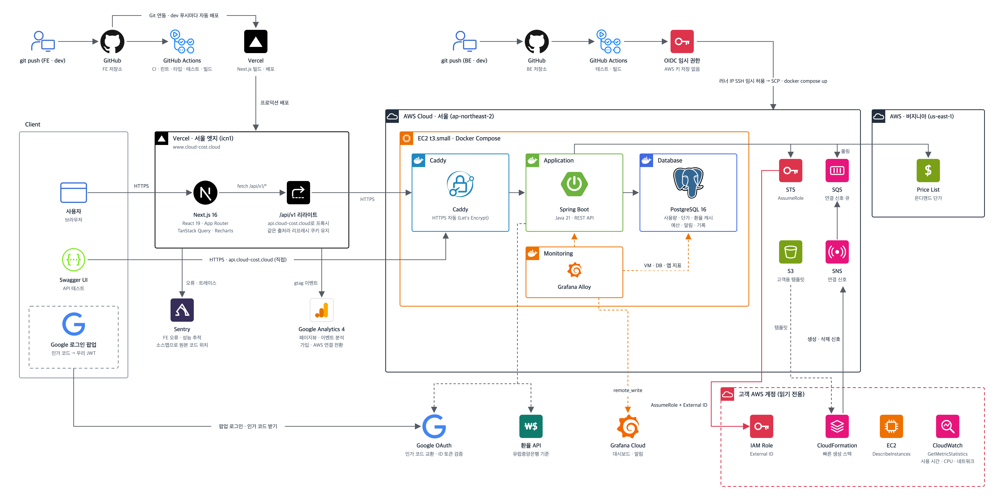

# CloudCost Backend

> AWS 계정을 **읽기 전용 IAM Role**로 연결하면 EC2 사용 시간과 예상 비용을 분석하고, 불필요한 리소스와 비용 급증을 탐지해 절감 가능 금액까지 확인할 수 있는 클라우드 비용 관리 서비스입니다.
> 
> Access Key를 별도로 발급하거나 입력할 필요가 없으며, 고객 AWS 계정의 리소스를 변경하지 않는 읽기 전용 방식으로 동작합니다. AWS 계정이 없는 사용자도 체험 모드를 통해 주요 기능을 확인할 수 있습니다.

## Architecture



- 프론트엔드(Next.js)는 Vercel 서울 엣지에서 서비스하며, 브라우저의 `/api/v1` 요청을 Vercel 리라이트로 이 서버(Caddy)에 넘깁니다. 같은 출처라 리프레시 쿠키가 그대로 오갑니다. → [CLOUD-COST-FE](https://github.com/cloudcost-team/CLOUD-COST-FE)
- 프론트엔드 오류·성능은 Sentry, 사용자 행동은 Google Analytics 4로 수집합니다.

## Key Features

| | 영역 | 한 줄 요약 |
|---|---|---|
| 🔗 | [AWS 연동 · 사용량](#1-aws-연동--사용량) | 링크 한 번으로 읽기 전용 연결, 최대 90일 사용 시간과 추정 비용 |
| 📊 | [비용 모니터링 · 예산](#2-비용-모니터링--예산) | 이번 달 누적 · 월말 예상 · 예산 · 비용 급증과 원인 |
| 💡 | [최적화 · 절감](#3-최적화--절감) | 과다 사양 · 유휴 서버 탐지, 추천 타입과 월 절감액 |
| 📈 | [비교 · 리포트](#4-비교--리포트) | 비슷한 규모 팀과 비교, 월간 리포트 |
| 🔔 | [알림 · 체험 모드](#5-알림--체험-모드) | 예산 · 급증 알림, AWS 계정 없이 체험 |
| 🔒 | [인증 · 보안](#6-인증--보안) | Google 로그인, 허용 API 2개, 사용자별 데이터 격리 |

### 1. AWS 연동 · 사용량

| 기능 | 내용 |
|---|---|
| 원클릭 연결 | CloudFormation 빠른 생성 링크 → SNS · SQS 신호로 연결 자동 검증 |
| 사용 시간 | CloudWatch 지표로 최대 90일 소급 수집 |
| 추정 비용 | 사용 시간 × 온디맨드 단가, 일별 · 월별 |
| 통화 | USD · KRW |

### 2. 비용 모니터링 · 예산

| 기능 | 내용 |
|---|---|
| 대시보드 | 이번 달 누적, 월말 예상, 전월 같은 기간 비교 |
| 월 예산 | 연결별 예산, 지난 3개월 평균으로 범위 제안 |
| 급증 탐지 | 직전 30일 일별 비용 중앙값 기준 |
| 원인 분석 | 사용 시간이 가장 많이 늘어난 인스턴스 표시 |

### 3. 최적화 · 절감

| 기능 | 내용 |
|---|---|
| 낭비 탐지 | 최근 14일 CPU · 네트워크로 과다 사양 · 유휴 판정 |
| 타입 추천 | 사용량에 맞는 더 싼 인스턴스 타입 |
| 절감액 | 추천 적용 시 월 절감액과 판단 근거 |
| 시뮬레이터 | 추천 적용 · 트래픽 증가율에 따른 월 · 연 비용, 예산 영향 |

### 4. 비교 · 리포트

| 기능 | 내용 |
|---|---|
| 팀 벤치마킹 | 비슷한 EC2 규모 팀과 과다 사양 비율 · 월 지출 비교 |
| 비교 기준 | Azure Public Dataset V2로 만든 분포 · 백분위 |
| 월간 리포트 | 월 비용, 전월 대비, 급증일, 인스턴스별 비중, 절감 제안 |
| 리포트 이력 | 최대 14개월 |

### 5. 알림 · 체험 모드

| 기능 | 내용 |
|---|---|
| 알림 | 예산 80% · 100% · 120%, 비용 급증 |
| 주간 요약 | 주간 비용과 주요 분석 결과 |
| 알림 관리 | 헤더 목록, 읽음 처리, 이력 |
| 체험 모드 | AWS 계정 없이 서버 구성 · 사용 패턴을 정해 같은 계산 로직으로 체험 |

### 6. 인증 · 보안

| 기능 | 내용 |
|---|---|
| 로그인 | Google 팝업 인가 코드 교환 · ID Token 검증 후 자체 JWT 발급 |
| 읽기 전용 연동 | STS AssumeRole + 연결별 External ID |
| 최소 권한 | 고객 계정에는 `ec2:DescribeInstances`, `cloudwatch:GetMetricStatistics`만 호출 |
| 데이터 격리 | 모든 조회에 `owner_id` 조건, 남의 리소스는 404 |
| 호출 최소화 | 조회 시점 수집 + DB 캐시, CloudWatch는 계정당 1시간에 1회 |

## API Documentation

| 구분 | URL |
|---|---|
| Swagger UI | `http://localhost:8080/swagger-ui.html` |
| OpenAPI | `http://localhost:8080/v3/api-docs` |
| 로그인 테스트 | `http://localhost:8080/login.html` |
| API 계약 | [docs/API.md](docs/API.md) |

모든 API 경로는 `/api/v1`을 기준으로 합니다.

## Tech Stack

### Backend

| 기술 | 활용 |
|---|---|
| Java 21 | 주요 개발 언어 |
| Spring Boot 3.5 | Spring Web MVC, Validation 기반 API 서버 |
| Spring Data JPA | 데이터 접근 및 ORM |
| Springdoc OpenAPI | API 명세 및 Swagger UI 제공 |

### Database

| 기술 | 활용 |
|---|---|
| PostgreSQL 16 | 서비스 데이터 저장 |
| Flyway | 데이터베이스 스키마 버전 관리 및 마이그레이션 |

### AWS Integration

| 서비스 | 활용 |
|---|---|
| STS | External ID 기반 고객 Role AssumeRole |
| EC2 | 고객 계정의 인스턴스 정보 조회 |
| CloudWatch | 고객 계정의 사용량 메트릭 조회 |
| Price List | 온디맨드 인스턴스 단가 조회 (서비스 계정) |
| CloudFormation | 고객용 읽기 전용 IAM Role 생성 |
| SNS · SQS | AWS 계정 연결 완료 신호 전달 및 검증 |

### External Data

| 기술 | 활용 |
|---|---|
| Frankfurter | USD → KRW 환율 조회 및 6시간 DB 캐싱 |
| Azure Public Dataset V2 | 팀 벤치마킹 기준 데이터 산출 |

### Authentication & Security

| 기술 | 활용 |
|---|---|
| Google Identity Services | Google 로그인 |
| Nimbus JOSE + JWT | Google ID Token 검증 및 서비스 JWT 발급 |
| ArchUnit | 헥사고날 아키텍처 의존 규칙 및 AWS 허용 API 검증 |

### Testing

| 기술 | 활용 |
|---|---|
| JUnit 5 | 단위 및 통합 테스트 |
| Mockito | 의존성 Mocking |
| AssertJ | 테스트 검증 |
| H2 | 테스트용 데이터베이스 |
| ArchUnit | 아키텍처 및 보안 규칙 검증 |

- 일반 테스트는 H2와 Fake AWS Adapter를 사용하며 실제 AWS API를 호출하지 않습니다.
- 실제 AWS 계정을 사용하는 테스트는 `@Tag("aws")`로 분리하고 `./gradlew awsTest`로 실행합니다.

### Infrastructure & Deployment

| 기술 | 활용 |
|---|---|
| EC2 | 백엔드 애플리케이션 운영 |
| Docker Compose | 애플리케이션 및 PostgreSQL 컨테이너 관리 |
| Caddy | HTTPS 인증서 자동 발급 및 리버스 프록시 |
| GitHub Actions | CI 테스트 및 CD 자동 배포 |
| AWS OIDC | 배포 파이프라인의 AWS 인증 |
| Grafana Cloud + Alloy | VM, PostgreSQL, 애플리케이션 메트릭 수집 및 모니터링 |

### Collaboration & Development

- **CodeRabbit:** PR 자동 코드 리뷰
- **Discord Webhook:** PR 및 이슈 알림 자동화
- **Claude Code Harness:** BE·FE 공통 기획 문서, 개발 규칙 및 스킬 관리

`.harness`를 Git Submodule로 관리하고, `.claude`에서 `.harness/be`를 참조하도록 구성했습니다.

## Project Structure

헥사고날 아키텍처를 기반으로 도메인, 애플리케이션, 어댑터, 진입점을 분리했습니다.

각 계층의 의존 방향은 ArchUnit 테스트로 검증하며, AWS SDK와 JPA에 대한 직접 의존은 지정된 어댑터 계층에서만 허용합니다.

```text
src/main/java/com/cloudcost/
├── CloudCostApplication.java
│
├── domain/                  # 순수 Java 비즈니스 로직
│   ├── account/             # AWS 연결, External ID, Role 정책
│   ├── ec2/                 # 인스턴스 정보 및 수집 상태
│   ├── usage/               # 사용 시간 및 사용량 집계
│   ├── cost/                # 비용 계산 및 통화
│   ├── budget/              # 월 예산 및 월말 예상
│   ├── waste/               # 낭비 탐지 및 절감액 계산
│   ├── spike/               # 비용 급증 탐지 및 원인 분석
│   ├── simulation/          # 비용 시뮬레이션
│   ├── benchmark/           # 팀 벤치마킹
│   ├── alert/               # 알림 조건 및 문구
│   ├── report/              # 월간 리포트
│   ├── demo/                # 체험 모드
│   ├── user/                # 사용자 및 외부 로그인 정보
│   └── sync/                # 데이터 수집 기록
│
├── application/             # 유스케이스 및 Port
│   ├── port/                # 외부 시스템 인터페이스
│   └── error/               # 애플리케이션 예외
│
├── adapter/                 # Port 구현체
│   ├── awscustomer/         # 고객 AWS: STS, EC2, CloudWatch
│   ├── awsinternal/         # 서비스 AWS: Price List, SQS, CloudFormation
│   ├── auth/                # Google Token 검증 및 JWT
│   ├── fx/                  # 환율 API
│   ├── benchmark/           # 벤치마킹 JSON 데이터
│   └── persistence/         # JPA Entity 및 Repository
│
└── entrypoint/              # 외부 요청 진입점
    ├── api/                 # REST Controller, DTO, 인증, 예외 처리
    ├── worker/              # SQS 메시지 처리
    ├── logging/             # 민감 정보 마스킹
    └── config/              # Bean 조립 및 환경 설정

src/main/resources/
├── application.yml
├── application-local.yml
├── application-prod.yml
├── db/migration/            # Flyway 마이그레이션 (V1 ~ V8)
├── cloudformation/          # 고객용 Read Only Role 템플릿
├── benchmark/
│   └── reference.json       # 벤치마킹 기준 데이터
└── static/
    └── login.html           # 로그인 테스트 페이지

scripts/
├── customer-role-allowlist.txt
└── benchmark/
    └── AzureOversized.java  # Azure 원본 데이터 재계산

deploy/                      # Dockerfile, Compose, Caddy, 모니터링 설정
docs/                        # 아키텍처, API, 데이터 모델, 보안, 배포 문서
.github/                     # GitHub Actions, 이슈 및 PR 템플릿
.harness/                    # Claude Code Harness Submodule
```

## Getting Started

### Requirements

- Java 21
- Docker
- AWS CLI (실제 AWS 계정 연동 시)

실제 AWS 연결을 위한 사전 설정은 [AWS_SETUP_GUIDE.md](docs/AWS_SETUP_GUIDE.md)를 참고합니다.

### Clone

하네스가 Git Submodule로 관리되므로 함께 클론합니다.

```bash
git clone --recurse-submodules https://github.com/cloudcost-team/CLOUD-COST-BE.git
```

이미 저장소를 클론했다면 다음 명령어로 Submodule을 초기화합니다.

```bash
git submodule update --init
```

### Run Locally

PostgreSQL을 실행한 후 Spring Boot 애플리케이션을 실행합니다.

```bash
docker compose up -d db
./gradlew bootRun
```

기본 실행 환경은 `AUTH_MODE=dev`입니다.

실제 AWS 계정 연동에 필요한 환경 변수(`CCI_BACKEND_ROLE_ARN`, `CCI_CALLBACK_QUEUE_URL` 등)는 [docs/AWS_SETUP_GUIDE.md](docs/AWS_SETUP_GUIDE.md) 3절을 참고합니다.

### Run Tests

일반 테스트는 H2와 Fake AWS Adapter를 사용하므로 실제 AWS 계정 없이 실행할 수 있습니다.

```bash
./gradlew test
```

특정 테스트만 실행하려면 다음 명령어를 사용합니다.

```bash
./gradlew test --tests com.cloudcost.application.UsageRefreshTest
```

실제 AWS 계정을 대상으로 하는 테스트는 별도로 실행합니다.

```bash
./gradlew awsTest
```

해당 테스트에는 `CCI_IT_ROLE_ARN` 등의 환경 변수가 필요합니다.

## CI/CD

GitHub Actions를 통해 테스트와 배포를 자동화합니다.

| Workflow | Trigger | Process |
|---|---|---|
| `ci.yaml` | `dev`, `main` 대상 PR 및 `main` Push | JDK 21 설정 → 테스트 실행 → 실패 시 테스트 리포트 업로드 |
| `cd.yaml` | `dev` Push (문서 파일만 변경된 경우 제외) | CI 통과 → JAR 빌드 → AWS OIDC 인증 → SSH 임시 허용 → 서버 배포 → 기동 확인 → SSH 허용 해제 |
| `discord-notify.yaml` | PR 생성·머지 및 이슈 등록 | Discord 리뷰 요청 및 변경 사항 알림 |

배포 과정에서는 GitHub Actions의 OIDC를 활용하며, SSH 접근은 배포 러너 IP에 한해 일시적으로 허용합니다.

자세한 설정은 [docs/DEPLOY.md](docs/DEPLOY.md) 10절을 참고합니다.

## Development Guidelines

### Architecture & Business Logic

- 사용 시간, 비용, 캐시 판단 등 핵심 계산 로직은 `domain/`에서 처리합니다.
- `domain/`은 Spring, AWS SDK, JPA에 직접 의존하지 않습니다.
- 외부 시스템 연동은 `application/port/`에 정의한 인터페이스를 통해 수행합니다.

### AWS Security

- 고객 계정에서는 `ec2:DescribeInstances`, `cloudwatch:GetMetricStatistics`만 호출합니다.
- 허용 API 목록은 `scripts/customer-role-allowlist.txt`에서 관리합니다.
- AWS 권한 추가는 사전 검토 및 ADR 작성 후 진행합니다.
- 고객 계정의 리소스를 변경하는 API는 사용하지 않습니다.

### Data Management

- 모든 사용자 데이터 조회에는 `owner_id` 조건을 적용합니다.
- 사용자 소유권 검증 없이 `findById`, `findAll` 등을 사용하지 않습니다.
- DB 스키마 변경은 새로운 Flyway 마이그레이션 파일로 추가합니다.
- 이미 적용된 마이그레이션 파일은 수정하지 않습니다.

### Documentation

- API 또는 테이블 변경 시 `docs/API.md`, `docs/DATA_MODEL.md`를 함께 수정합니다.
- 설계 기준이나 주요 의사결정이 변경되면 ADR을 작성합니다.
- 기능 범위와 화면 문구는 Harness의 기능 명세서 및 화면 설계를 기준으로 합니다.

### Configuration & Secrets

- Access Key, 비밀번호, 실제 AWS 계정 ID 및 ARN 등 민감한 값은 저장소에 커밋하지 않습니다.
- 환경 변수 또는 GitHub Actions Secrets를 통해 관리합니다.

## Branch Strategy

```text
main                     # 안정 버전
dev                      # 개발 통합 및 자동 배포
feat/#이슈번호-기능명
fix/#이슈번호-버그명
```

예시:

```text
feat/#12-cost-forecast
fix/#34-usage-timezone
```

## Commit Convention

커밋 메시지는 `타입: 한국어 설명` 형식을 사용합니다.

| Type | Description |
|---|---|
| `feat` | 새로운 기능 추가 |
| `fix` | 버그 수정 |
| `refactor` | 코드 리팩토링 |
| `docs` | 문서 수정 |
| `test` | 테스트 코드 추가 및 수정 |
| `chore` | 빌드, 설정 및 배포 관련 변경 |

예시:

```text
feat: 일별 추정 비용 API 추가
fix: KST 날짜 경계 사용 시간 집계 오류 수정
```

## Pull Request

- 기능 개발 전 GitHub Issue를 생성합니다.
- Feature, Refactor, Fix, Chore 템플릿을 목적에 맞게 사용합니다.
- `dev` 브랜치를 대상으로 PR을 생성합니다.
- [PR Template](.github/PULL_REQUEST_TEMPLATE.md)의 체크리스트를 작성합니다.
- CI 테스트(`./gradlew test`) 통과 후 머지합니다.
- `dev` 브랜치에 머지되면 자동 배포됩니다.

## Documentation

| Document | Description |
|---|---|
| [ARCHITECTURE.md](docs/ARCHITECTURE.md) | 헥사고날 아키텍처, 데이터 수집 및 캐싱 흐름, 환경 변수 |
| [API.md](docs/API.md) | API 명세 및 계약 |
| [DATA_MODEL.md](docs/DATA_MODEL.md) | 데이터베이스 테이블 및 관계 |
| [SECURITY.md](docs/SECURITY.md) | AWS 권한 및 서비스 보안 정책 |
| [AWS_SETUP_GUIDE.md](docs/AWS_SETUP_GUIDE.md) | AWS 계정 연동 및 사전 설정 |
| [DEPLOY.md](docs/DEPLOY.md) | 인프라 구성 및 CI/CD 배포 |
| [decisions/](docs/decisions/) | ADR 001~016: 주요 기술 및 설계 의사결정 기록 |
